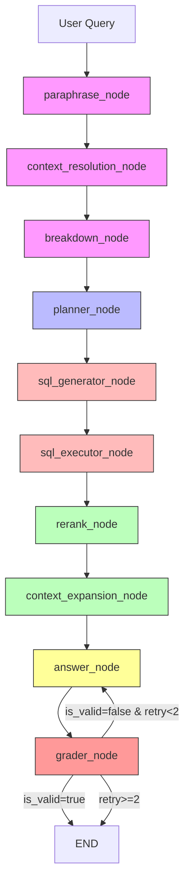

# RAG Model Architecture Analysis

This document provides a comprehensive analysis of the RAG (Retrieval-Augmented Generation) codebase in `/home/raid/nlp-nlp/NLP/Vishal`.

---

## 1. High-Level Architecture

### System Overview
```
FastAPI Server (main.py)
        │
        ▼
   LangGraph Workflow (graph.py)
        │
        ▼
┌───────────────────────────────────────────────────────┐
│  10-Node Pipeline (Sequential with Grader Retry)     │
│                                                       │
│  paraphrase → context_resolution → breakdown         │
│       ↓                                               │
│  planner → sql_generator → sql_executor              │
│       ↓                                               │
│  rerank → context_expansion → answer → grader        │
│       ↓                     ↑                        │
│      END  ←─────────────────┴─ RETRY (if invalid)   │
└───────────────────────────────────────────────────────┘
```

### Key Files Structure
```
Vishal/
├── main.py                    # FastAPI server entry point
├── graph.py                   # LangGraph workflow definition
├── state.py                   # TypedDict state schema
├── config.yaml                # Configuration (NOT USED!)
├── nodes/                     # 10 pipeline nodes
│   ├── __init__.py
│   ├── preprocessing.py       # paraphrase, context_resolution, breakdown
│   ├── planner.py             # domain/intent/issue classification
│   ├── sql_generator.py       # SQL generation with retry
│   ├── sql_executor.py        # SQL execution with fallback
│   ├── reranker.py            # Cross-encoder reranking
│   ├── context_expansion.py   # Window retrieval
│   ├── answer.py              # Final answer generation
│   └── grader.py              # Quality validation
├── prompts/                   # LLM prompts
│   ├── __init__.py
│   ├── preprocessing.py
│   ├── classification.py
│   ├── sql.py
│   └── answer.py
├── utils/                     # Utilities
│   ├── __init__.py
│   ├── db.py                  # Database pool & queries
│   ├── embed.py               # Embedding generation
│   └── helpers.py             # JSON extraction, formatting
├── agents/
│   └── schema_agent.py        # Pre-computed DB statistics
└── model/
    └── model.py               # LLMFactory (UNUSED!)
```

---

## 2. Pipeline Nodes Analysis

### Node 1: `paraphrase_node` (preprocessing.py:16-36)
- **Purpose**: Paraphrase user query for clarity
- **LLM**: gpt-4o-mini
- **Input**: `user_query`
- **Output**: `paraphrased_query`, `standalone_query`
- **⚠️ ISSUE**: Sets both outputs to same value (redundant)

### Node 2: `context_resolution_node` (preprocessing.py:39-70)
- **Purpose**: Resolve context from chat history
- **LLM**: gpt-4o-mini
- **Input**: `paraphrased_query`, `chat_history`
- **Output**: `standalone_query`
- **Status**: ✅ Works correctly

### Node 3: `breakdown_node` (preprocessing.py:73-95)
- **Purpose**: Break query into Quantitative_Tasks and Qualitative_Tasks
- **LLM**: gpt-4o-mini
- **Input**: `standalone_query`
- **Output**: `subqueries` dict
- **⚠️ POTENTIAL HALLUCINATION**: LLM may create unnecessary task splits

### Node 4: `planner_node` (planner.py:21-108)
- **Purpose**: Classify tasks by domain, intent, issue categories
- **LLM**: gpt-4o-mini
- **Input**: `subqueries`
- **Output**: `task_dict`
- **⚠️ ISSUE**: Runs 3 parallel LLM calls per task (expensive)
- **⚠️ POTENTIAL HALLUCINATION**: Domain/intent may not match actual DB values

### Node 5: `sql_generator_node` (sql_generator.py:49-139)
- **Purpose**: Generate SQL with retry logic
- **LLM**: gpt-4o (main model)
- **Input**: `subqueries`, `task_dict`
- **Output**: `sql_plan`
- **⚠️ CRITICAL ISSUE**: Max 2 retries, but probe_sql doesn't properly validate
- **⚠️ POTENTIAL HALLUCINATION**: LLM may generate invalid column names

### Node 6: `sql_executor_node` (sql_executor.py:29-127)
- **Purpose**: Execute SQL with fallback to vector search
- **Input**: `sql_plan`, `subqueries`
- **Output**: `raw_results`, `fallback_tasks`
- **Status**: ✅ Good fallback mechanism

### Node 7: `rerank_node` (reranker.py:67-101)
- **Purpose**: Cross-encoder reranking of results
- **Model**: cross-encoder/ms-marco-MiniLM-L-12-v2
- **Input**: `raw_results`, `standalone_query`
- **Output**: `results` (top 7 per task)
- **Status**: ✅ Solid implementation

### Node 8: `context_expansion_node` (context_expansion.py:60-100)
- **Purpose**: Fetch surrounding chunks for context
- **Input**: `results`
- **Output**: `results` with `expanded_context`
- **⚠️ ISSUE**: Depends on `start_end_lines` format "X-Y"

### Node 9: `answer_node` (answer.py:91-160)
- **Purpose**: Generate final answer
- **LLM**: gpt-4o
- **Input**: `user_query`, `results`, `chat_history`, etc.
- **Output**: `final_answer`, `chat_history`
- **Status**: ✅ Well-structured

### Node 10: `grader_node` (grader.py:21-102)
- **Purpose**: Validate answer quality
- **LLM**: gpt-4o-mini
- **Input**: `final_answer`, `results`, `standalone_query`
- **Output**: `is_answer_valid`, `grader_feedback`
- **⚠️ ISSUE**: Citation check uses regex, may be too strict

---

## 3. UNUSED CODE (Dead Code)

### 3.1 `model/model.py` - LLMFactory Class
**ENTIRE FILE IS UNUSED!**
- Defined `LLMFactory` class with multi-provider support
- Supports: Gemini, OpenAI, HuggingFaceHub, Ollama
- **Never imported** by any other file
- Nodes hardcode `ChatOpenAI` directly instead

```python
# In model/model.py - NEVER USED
class LLMFactory:
    def __init__(self, config_path: str):
        ...
```

### 3.2 `config.yaml` - Configuration File
**PARTIALLY UNUSED!**
- File exists but **NOT loaded** by any code
- Nodes hardcode model names directly:
  - `nodes/preprocessing.py:13`: `llm_mini = ChatOpenAI(model="gpt-4o-mini")`
  - `nodes/planner.py:18`: `llm_mini = ChatOpenAI(model="gpt-4o-mini")`
  - `nodes/sql_generator.py:14`: `llm = ChatOpenAI(model="gpt-4o")`

**CONFIG VALUES NEVER USED:**
```yaml
embeddings:
  provider: openai
  model: text-embedding-3-small     # ← NEVER USED!
  dimensions: 1536
```
**Actual code uses `e5-base-v2` (HuggingFace) in `utils/embed.py`!**

### 3.3 `utils/helpers.py:63-81` - `truncate_results` Function
**NEVER CALLED!**
- Defined but never imported or used
- `format_context_data` in `answer.py` does similar work

### 3.4 `agents/__init__.py` - Missing Export
- Exports `SchemaUnderstandingAgent` class
- But `get_schema_agent` function is NOT exported (must import from submodule)

### 3.5 `prompts/__init__.py` - Missing `build_sql_prompt`
- `build_sql_prompt` function exists in `prompts/sql.py`
- NOT exported in `__init__.py` (but imported directly in `sql_generator.py`)

---

## 4. CONFIGURATION MISMATCHES

### 4.1 Embedding Model Mismatch
| Location | Value |
|----------|-------|
| `config.yaml` | `text-embedding-3-small` (OpenAI) |
| `utils/embed.py` | `intfloat/e5-base-v2` (HuggingFace) |

**IMPACT**: Config suggests OpenAI embeddings but code uses HuggingFace.
If DB was indexed with OpenAI embeddings, vector search will FAIL!

### 4.2 Vector Dimensions
| Source | Dimensions |
|--------|------------|
| `config.yaml` | 1536 |
| `prompts/sql.py` COMMON_SCHEMA | 1536 (hardcoded) |
| `e5-base-v2` model | 768 |

**POTENTIAL BUG**: If using e5-base-v2, DB schema says 1536 dims but model produces 768!

---

## 5. POTENTIAL LLM HALLUCINATION TRACES

### 5.1 SQL Generation (`sql_generator.py`)
- **Problem**: LLM may invent columns that don't exist
- **Mitigation**: `probe_sql` checks syntax but doesn't validate semantics
- **Evidence**: `prompts/sql.py:156-162` has schema reminders for retries

### 5.2 Domain/Intent Classification (`planner.py`)
- **Problem**: LLM may classify into domains/intents not in actual DB
- **Hardcoded Valid Tags**: `classification.py:30-33` defines `VALID_TAGS`
- **Gap**: No validation that classified values exist in actual data

### 5.3 Query Breakdown (`preprocessing.py`)
- **Problem**: LLM may create overly granular or incorrect task splits
- **Impact**: More tasks = more SQL queries = slower response
- **Mitigation**: Limits (max 2 quant, max 3 qual tasks)

### 5.4 Issue Categories (`classification.py:82-117`)
- **Problem**: The 22 issue categories may not match actual `issue_categories` in DB
- **No validation** that LLM-chosen categories exist in the database

---

## 6. SCHEMA AGENT (Not Integrated)

### Location: `agents/schema_agent.py`

**Purpose**: Pre-compute DB statistics for smarter SQL generation

**Features**:
- Domain counts
- Intent distributions
- Issue correlations
- Tag vocabulary

**CRITICAL ISSUE**: 
- `get_context_for_query()` method exists but is **NEVER CALLED**!
- Schema agent initializes at startup but context is not passed to SQL generator
- `sql_generator_node` doesn't use `schema_context` from state

---

## 7. STATE SCHEMA ANALYSIS

### File: `state.py`

```python
class State(TypedDict, total=False):
    user_query: str
    chat_history: List[dict]
    paraphrased_query: str
    standalone_query: str
    subqueries: dict       # {Quantitative_Tasks: [...], Qualitative_Tasks: [...]}
    task_dict: dict        # {task: {domain, intent, issue_categories}}
    sql_plan: dict         # {task: {sql, rationale}}
    raw_results: dict      # Before reranking
    results: dict          # After reranking & expansion
    fallback_tasks: List[str]
    schema_context: dict   # ← NEVER POPULATED!
    final_answer: str
    retry_count: int
    grader_feedback: str
    is_answer_valid: bool
```

**⚠️ UNUSED STATE FIELDS:**
- `schema_context` - defined but never set by any node

---

## 8. DATABASE SCHEMA (From Prompts)

### Defined in `prompts/sql.py:3-27`

```sql
TABLE transcripts(
    transcript_id UUID PRIMARY KEY,
    domain VARCHAR,              -- [Hotel, Flight, Retail, Banking, Telecom, Insurance]
    intent VARCHAR,              -- e.g., 'Cancellation Policies', 'Fraud Alerts'
    issue_categories TEXT[],     -- Array of strings
    timestamp TIMESTAMP
)

TABLE transcript_chunks(
    start_end_lines TEXT,        -- e.g., '5-15' (line range)
    transcript_id UUID REFERENCES transcripts(transcript_id),
    chunk_text TEXT,             -- The actual conversation text
    chunk_tags TEXT[],           -- Array of ~100 tags
    embedding VECTOR(1536),      -- PGVector column
    text_search_vector TSVECTOR, -- For BM25/FTS search
    PRIMARY KEY (start_end_lines, transcript_id)
)
```

**DEPENDENCIES**:
- PostgreSQL with pgvector extension
- TSVECTOR for full-text search

---

## 9. RECOMMENDED FIXES

### Priority 1: Critical Bugs
1. **Fix embedding dimension mismatch** - Verify DB uses same model as `embed.py`
2. **Remove or use config.yaml** - Either load it or delete it
3. **Delete unused `model/model.py`** - Reduces confusion

### Priority 2: Integration Fixes
4. **Integrate schema_agent context** - Pass to sql_generator
5. **Export `get_schema_agent`** in `agents/__init__.py`
6. **Remove `truncate_results`** from helpers.py

### Priority 3: Robustness
7. **Add domain/intent validation** - Check against actual DB values
8. **Improve grader regex** - Too strict on citation format
9. **Add proper error handling** in reranker fallback

---

## 10. GRAPH VISUALIZATION



**Legend:**
- 🟣 Pink: Preprocessing nodes
- 🔵 Blue: Classification nodes  
- 🔴 Red: SQL nodes
- 🟢 Green: Retrieval enhancement nodes
- 🟡 Yellow: Answer generation
- 🟠 Orange: Validation

---

## 11. LLM MODELS USED

| Node | Model | Cost Tier |
|------|-------|-----------|
| paraphrase | gpt-4o-mini | Low |
| context_resolution | gpt-4o-mini | Low |
| breakdown | gpt-4o-mini | Low |
| planner (3 calls/task) | gpt-4o-mini | Medium |
| sql_generator | gpt-4o | HIGH |
| answer | gpt-4o | HIGH |
| grader | gpt-4o-mini | Low |
| reranker | CrossEncoder | Local/Free |
| embeddings | e5-base-v2 | Local/Free |

---

## Summary of Issues Found

| Category | Issue | Severity |
|----------|-------|----------|
| Dead Code | `model/model.py` unused | Medium |
| Dead Code | `truncate_results()` unused | Low |
| Config | `config.yaml` not loaded | High |
| Config | Embedding model mismatch | Critical |
| Integration | Schema agent not integrated | High |
| State | `schema_context` never set | Medium |
| Hallucination | No domain validation | Medium |