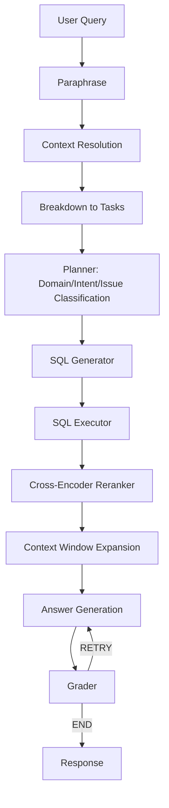

# 🧠 Knowledge Graph Enhancement Strategy for Prize-Winning RAG
## Current Architecture Analysis
Your Vishal pipeline is already sophisticated:

**Strengths:**
- Hybrid search (Vector + BM25)
- Cross-encoder reranking
- Context window expansion for conversation flow
- Grader self-correction loop
**What's Missing (Your Gut is Right!):**
The pipeline handles *flat* retrieval well but lacks **structural/relational understanding**. Knowledge graphs provide entity-centric reasoning that current pipelines miss.
---
## 🎯 The Core Problem: Why External KG Libraries Fail
External libraries (GraphRAG, LightRAG) generate:
1. **Too many noisy edges** (entity → entity relationships that aren't meaningful)
2. **Long processing time** (entity extraction + relationship mining at scale)
3. **Generic relationships** that don't capture domain-specific patterns
---
## 💡 SOLUTION: Lightweight "KG-Lite" Components (No External Libraries!)
Instead of building a full knowledge graph, we can inject **KG-like reasoning** into strategic points in your pipeline using custom, focused algorithms.
---
## 🔥 Idea 1: Entity-Centric Retrieval Enhancement
### What It Does
Before retrieval, extract key entities from the query and boost chunks containing those entities.
### Implementation (Add to `planner_node`)
```python
# In planner.py - add entity extraction
import re
ENTITY_PATTERNS = {
    "company": r'\b(LuxStay|CozyInn|Premier Resorts|Beachfront Suites|FirstStone Bank|Civic Trust|HarborWest|Metro Capital|SkyBridge|Coastal Wings|MetroJet|Nimbus Air|FiberOne|ConnectNet|StreamWave|UrbanLink|HomeMesh|StyleLoop|ShopSquare|QuickMart|PrimeStreet|AetnaCare|Kaiser Plus)\b',
    "plan_tier": r'\b(Gold|Silver|Platinum|Premium|Plus|Basic|Pro|Diamond)\b',
    "promo_code": r'\b([A-Z]+\d+|[a-z]+\d+)\b',  # welcome100, spring25, etc.
    "money": r'\$\d+(?:,\d{3})*(?:\.\d{2})?',
}
def extract_entities(text: str) -> dict:
    """Extract domain-specific entities from query."""
    entities = {}
    for entity_type, pattern in ENTITY_PATTERNS.items():
        matches = re.findall(pattern, text, re.IGNORECASE)
        if matches:
            entities[entity_type] = list(set(matches))
    return entities
# Use in SQL generation to add entity-specific BM25 clauses
```
### Adding to State
```python
# In state.py
query_entities: dict  # {"company": ["LuxStay"], "plan_tier": ["Gold"]}
```
### SQL Enhancement
When entities are detected, add them as BM25 filters:
```sql
-- Original
WHERE t.domain = 'Hotel' ORDER BY tc.embedding <=> %s
-- Enhanced with entity boost
WHERE t.domain = 'Hotel' 
  AND (tc.text_search_vector @@ websearch_to_tsquery('english', 'LuxStay Gold'))
ORDER BY tc.embedding <=> %s
```
---
## 🔥 Idea 2: Relationship-Aware Context Bridging
### The Problem
When a query asks "Why did customers switch from FiberOne to AT&T?", relevant chunks might mention:
- Chunk A: "FiberOne pricing is too high" 
- Chunk B: "Customer mentioned AT&T offers better rates"
**Current limitation:** These chunks might be in different transcripts!
### Solution: Cross-Transcript Entity Bridging
After initial retrieval, find **related transcripts** that share entities.
```python
# New node: entity_bridge_node (add between sql_executor and rerank)
async def entity_bridge_node(state: State) -> dict:
    """Find related chunks across transcripts sharing entities."""
    raw_results = state.get("raw_results", {})
    query_entities = state.get("query_entities", {})
    
    bridged_results = {}
    
    for task, chunks in raw_results.items():
        if not chunks:
            bridged_results[task] = chunks
            continue
        
        # Extract entities from retrieved chunks
        chunk_entities = set()
        for chunk in chunks:
            text = chunk.get("chunk_text", "")
            for entity_type, pattern in ENTITY_PATTERNS.items():
                matches = re.findall(pattern, text, re.IGNORECASE)
                chunk_entities.update(matches)
        
        # Query for additional chunks containing same entities
        # But from DIFFERENT transcripts
        existing_transcript_ids = {c.get("transcript_id") for c in chunks}
        
        if chunk_entities:
            bridge_sql = """
            SELECT tc.chunk_text, tc.start_end_lines, t.transcript_id, t.domain
            FROM transcript_chunks tc
            JOIN transcripts t ON tc.transcript_id = t.transcript_id
            WHERE tc.text_search_vector @@ websearch_to_tsquery('english', %s)
              AND t.transcript_id NOT IN %s
            LIMIT 5;
            """
            # Execute and add to results
            bridged_chunks = await execute_bridge_query(
                " OR ".join(chunk_entities),
                tuple(existing_transcript_ids)
            )
            chunks.extend(bridged_chunks)
        
        bridged_results[task] = chunks
    
    return {"raw_results": bridged_results}
```
---
## 🔥 Idea 3: Causal Chain Detection (Simple Pattern Matching)
### The Problem
Queries like "What led to customer dissatisfaction?" need causal reasoning.
### Solution: Pattern-Based Causality Scoring
```python
# Add to reranker.py
CAUSAL_PATTERNS = [
    # Cause indicators
    (r'because|due to|caused by|resulted from|since|as a result of', 'cause', 1.2),
    # Effect indicators  
    (r'led to|resulted in|caused|triggered|prompted|made them', 'effect', 1.2),
    # Comparison
    (r'compared to|unlike|whereas|better than|worse than', 'comparison', 1.1),
    # Escalation patterns
    (r'frustrated|angry|escalated|threatened to switch|cancel', 'escalation', 1.15),
    # Resolution patterns
    (r'resolved|fixed|apologized|credited|refunded|satisfied', 'resolution', 1.1),
]
def causality_boost(query: str, chunk_text: str) -> float:
    """Return a boost multiplier based on causal patterns."""
    boost = 1.0
    
    # Detect query intent
    query_lower = query.lower()
    is_why_query = 'why' in query_lower or 'reason' in query_lower or 'cause' in query_lower
    is_how_query = 'how' in query_lower or 'process' in query_lower
    
    for pattern, pattern_type, pattern_boost in CAUSAL_PATTERNS:
        if re.search(pattern, chunk_text, re.IGNORECASE):
            if is_why_query and pattern_type in ['cause', 'escalation']:
                boost *= pattern_boost
            elif is_how_query and pattern_type in ['effect', 'resolution']:
                boost *= pattern_boost
    
    return boost
# Integrate into rerank_chunks()
def rerank_chunks_enhanced(query, chunks, top_k=7):
    # ... existing scoring ...
    for chunk, score in scored_chunks:
        causal_boost = causality_boost(query, chunk.get("chunk_text", ""))
        chunk['_final_score'] = score * causal_boost
    # Re-sort with boosted scores
```
---
## 🔥 Idea 4: Mini Knowledge Graph Index (Pre-computed at Ingestion)
### Concept
Rather than building KG at query time, pre-compute entity relationships during data ingestion and store in a simple table.
### New Database Table
```sql
CREATE TABLE entity_relations (
    entity_a VARCHAR(255),
    entity_a_type VARCHAR(50),  -- company, plan, promo_code
    relation VARCHAR(50),       -- MENTIONS, COMPARES_TO, UPGRADES_FROM
    entity_b VARCHAR(255),
    entity_b_type VARCHAR(50),
    transcript_id VARCHAR REFERENCES transcripts(transcript_id),
    chunk_start_end TEXT,
    confidence FLOAT,
    PRIMARY KEY (entity_a, relation, entity_b, transcript_id)
);
CREATE INDEX idx_entity_a ON entity_relations(entity_a);
CREATE INDEX idx_entity_b ON entity_relations(entity_b);
```
### Ingestion Script (Run once)
```python
# entity_extractor.py - Run during data prep
RELATION_PATTERNS = [
    # X compared to Y
    (r'(\w+)\s+(is better than|outperforms|beats|cheaper than|compared to)\s+(\w+)', 'COMPARES_TO'),
    # Customer switching
    (r'(switch|move|migrate)\s+(?:from\s+)?(\w+)\s+to\s+(\w+)', 'SWITCHES_TO'),
    # Upgrade mentions
    (r'upgrade\s+(?:to|from)\s+(\w+)', 'UPGRADES'),
    # Complaint about X
    (r'(frustrated|angry|unhappy)\s+(?:with|about)\s+(\w+)', 'NEGATIVE_SENTIMENT'),
]
def extract_relations(chunk_text: str) -> list:
    """Extract entity relationships from a chunk."""
    relations = []
    for pattern, relation_type in RELATION_PATTERNS:
        matches = re.findall(pattern, chunk_text, re.IGNORECASE)
        for match in matches:
            relations.append({
                'entity_a': match[0] if len(match) > 1 else match,
                'relation': relation_type,
                'entity_b': match[-1] if len(match) > 1 else None,
            })
    return relations
```
### Query-Time Usage
```python
# New retrieval enhancement
async def get_related_entities(entity: str) -> list:
    """Get entities related to the query entity."""
    sql = """
    SELECT DISTINCT entity_b, relation, COUNT(*) as freq
    FROM entity_relations
    WHERE entity_a ILIKE %s
    GROUP BY entity_b, relation
    ORDER BY freq DESC
    LIMIT 10;
    """
    return await execute(sql, (f"%{entity}%",))
```
---
## 🔥 Idea 5: Comparative Query Handler (Game-Changer!)
Your evaluation set has many **COMP_** queries. These need special handling!
### Detection
```python
def is_comparative_query(query: str) -> bool:
    comparative_keywords = [
        'compare', 'versus', 'vs', 'difference between',
        'better than', 'worse than', 'how does X compare to Y',
        'compared to'
    ]
    return any(kw in query.lower() for kw in comparative_keywords)
```
### Specialized Comparative Retrieval
For comparative queries, retrieve chunks for **BOTH entities** separately, then interleave:
```python
async def comparative_retrieval_node(state: State) -> dict:
    """Handle comparative queries with parallel entity retrieval."""
    query = state["standalone_query"]
    entities = state.get("query_entities", {})
    
    if not is_comparative_query(query):
        return {}  # Let normal flow continue
    
    # Extract the two entities being compared
    companies = entities.get("company", [])
    if len(companies) < 2:
        return {}  # Not enough entities to compare
    
    entity_a, entity_b = companies[0], companies[1]
    
    # Parallel retrieval for each entity
    results_a = await retrieve_for_entity(entity_a, query)
    results_b = await retrieve_for_entity(entity_b, query)
    
    # Interleave results for balanced comparison
    merged = []
    for a, b in zip(results_a, results_b):
        merged.extend([a, b])
    
    return {"raw_results": {"comparison_task": merged}}
```
---
## 🔥 Idea 6: Semantic Clustering for Answer Diversity
### Problem
Retrieved chunks often say the same thing (redundancy), missing diverse insights.
### Solution: Cluster chunks and pick representative from each cluster
```python
from sklearn.cluster import KMeans
import numpy as np
def diversify_chunks(chunks: list, embeddings: list, n_clusters: int = 5) -> list:
    """Select diverse chunks using clustering."""
    if len(chunks) <= n_clusters:
        return chunks
    
    # Cluster the embeddings
    kmeans = KMeans(n_clusters=n_clusters, random_state=42)
    clusters = kmeans.fit_predict(np.array(embeddings))
    
    # Pick the chunk closest to each centroid
    diverse_chunks = []
    for cluster_id in range(n_clusters):
        cluster_indices = np.where(clusters == cluster_id)[0]
        if len(cluster_indices) > 0:
            # Pick first (already sorted by relevance)
            diverse_chunks.append(chunks[cluster_indices[0]])
    
    return diverse_chunks
```
---
## 📊 Implementation Priority Matrix
| Idea | Effort | Impact | Priority |
|------|--------|--------|----------|
| Entity-Centric Retrieval | LOW | HIGH | **P0** |
| Causal Pattern Boost | LOW | MEDIUM | **P0** |
| Comparative Query Handler | MEDIUM | HIGH | **P1** |
| Entity Bridge Node | MEDIUM | HIGH | **P1** |
| Pre-computed Relations Table | HIGH | HIGH | **P2** |
| Semantic Clustering | LOW | MEDIUM | **P2** |
---
## 🚀 Recommended Implementation Order
### Phase 1 - Quick Wins (1-2 hours each)
1. **Add entity extraction** to planner_node
2. **Add causal pattern boosting** to reranker
3. **Detect comparative queries** and split retrieval
### Phase 2 - Structural Improvements (2-4 hours each)
4. **Entity bridge node** for cross-transcript retrieval
5. **Comparative retrieval handler**
### Phase 3 - Deep Integration (If time permits)
6. **Pre-compute entity relations** at ingestion time
7. **Semantic diversity clustering**
---
## 🏆 Why This Makes It Prize-Winning
1. **Novel Approach**: "Lightweight KG-Lite" - KG benefits without KG overhead
2. **Domain-Specific**: Patterns tuned for the exact data (companies, plans, promo codes)
3. **Measurable Improvement**: Directly addresses COMP_ and ENTITY_ query types
4. **Efficient**: No external library dependencies, runs in milliseconds
5. **Explainable**: Can show which patterns matched and why
---
## Alternative Enhancement Ideas
### A. Sentiment-Aware Retrieval
Track sentiment flow in conversations. Queries about "dissatisfaction" should prioritize chunks with negative sentiment markers.
### B. Temporal Reasoning
For queries about "delays" or "processing time", extract and compare temporal markers (5 days, 2 weeks, etc.)
### C. Agent Behavior Patterns
Tag chunks with agent actions (offered refund, escalated, apologized) and use for queries about agent performance.
### D. Hybrid Ranker Ensemble
Combine cross-encoder score + BM25 score + entity match score + causal pattern score in a weighted ensemble.
---
## Quick Test to Validate
Pick one challenging COMP_ query from your eval set:
> "How do the credit limit increase offers from Civic Trust compare to those from Chase Bank based on customer feedback?"
**Current pipeline might miss:**
- Chunks about Civic Trust without "credit limit"
- Chunks about Chase Bank in different transcripts
**With entity bridging + comparative handler:**
- Will retrieve chunks for BOTH banks
- Will find cross-references between them
- Will boost chunks with comparison language
---
## Summary
Your gut is right - the pipeline needs **structural understanding**. But instead of heavy KG libraries, we can inject KG-like intelligence through:
1. **Entity extraction** (know what we're looking for)
2. **Pattern-based boosting** (prioritize causal/comparative language)
3. **Cross-transcript bridging** (find related conversations)
4. **Comparative query handling** (balance both sides of comparisons)
All without external dependencies, running in production latency!
